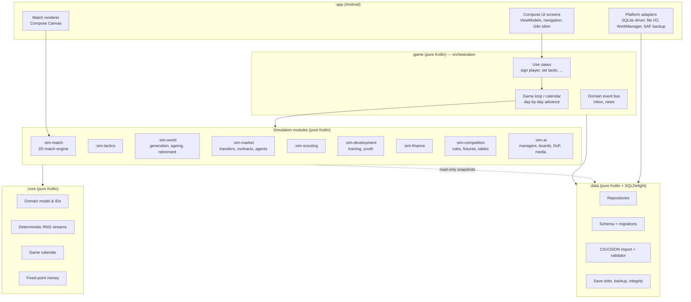

# Football Manager Android (working title) — Technical Blueprint

Status: **APPROVED 2026-11-14** — implementation under way; see FEATURE_CHECKLIST.md. (Save format changed to a snapshot for the MVP; see ARCHITECTURE.md.)
Date: 2026-11-14
Scope: Task 23 of the master prompt (project discovery and technical blueprint).

---

## 0. Discovery findings

### 0.1 Repository
| Item | Finding | Consequence |
|---|---|---|
| Content | `README.md` (unrelated Roblox "script injector" text), `LICENSE` (Apache-2.0), `link .txt` (a URL shortener link and an archive password) | No existing game code. Nothing to migrate. |
| Risk | The README + shortened download link + password pattern is a common malware-distribution pattern. It was **not opened or followed**. | Recommend replacing README and deleting `link .txt` (needs your approval — see §13). |
| Branch | `claude/football-manager-android-fwdfqi` | All work lands here. |

### 0.2 Build environment (cloud container)
| Tool | Status |
|---|---|
| JDK | OpenJDK 21 ✅ |
| Gradle | 8.14.3 ✅ |
| Kotlin compiler | via Gradle plugin (Gradle Plugin Portal reachable ✅) |
| Maven Central | reachable ✅ |
| **Google Maven (`dl.google.com` / `maven.google.com`)** | **blocked by network policy ❌** |
| Android SDK / `adb` / emulator | not installed ❌ |
| CPU / RAM / disk | 4 cores / 15 GB / ~31 GB free |

**Consequence:** every pure-Kotlin module (engine, simulation, database, generation, save system, stress tests) can be built and tested here today. The Android app module (Android Gradle Plugin, Jetpack Compose, AndroidX) **cannot** be compiled here until Google Maven is allowed and the Android SDK is installed. This shapes the architecture (engine fully independent of Android — which the prompt asks for anyway) and the milestone order.

---

## 1. Recommended technology stack

| Concern | Choice | Why (and what was rejected) |
|---|---|---|
| Language | **Kotlin 2.x** | Native Android language; same code runs on JVM for headless tests. |
| Module layout | **Gradle multi-module, pure Kotlin/JVM engine modules + one Android app module** | Engine testable without Android; 30–50-season stress tests run on desktop JVM in CI. |
| UI | **Jetpack Compose (Material 3)** | Data-dense tables, theming (dark/light), localization, portrait-first. |
| 2D match rendering | **Compose `Canvas`** | 22 players + ball + markings is ~30 draw calls/frame — trivial for Canvas at 60 fps. **LibGDX rejected**: second UI toolkit, second lifecycle, larger APK, no benefit at this visual complexity. Rendering is behind an interface so it could be swapped later. |
| Database | **SQLite via SQLDelight 2** | Typed SQL, works identically on Android and JVM (needed for headless stress tests), migrations as `.sqm` files, Maven Central only. **Room** considered: Room KMP also works on JVM, but its artifacts live on Google Maven and it hides SQL we need to tune for bulk simulation writes. |
| Concurrency | **kotlinx.coroutines** | Background world simulation, cancellable match sim, structured concurrency. |
| Serialization | **kotlinx.serialization (JSON + CBOR)** | Import/export, tactic presets, cloud backup envelopes. |
| DI | **Manual constructor injection + small `AppGraph`** (Koin optional later) | Engine has few singletons; avoids annotation processors and Hilt's Android coupling in engine modules. |
| Testing | JUnit 5 + kotlin.test, property tests (Kotest property module), Compose UI tests on device | Determinism and invariant testing dominate. |
| Online (optional, later) | **No backend in MVP.** Phase 7: export/import via Android Storage Access Framework (user's own Drive/files), then optional self-hostable sync service. | Zero paid services; offline-first is mandatory. Firebase etc. not introduced without approval. |
| Min/target SDK | minSdk 26 (Android 8), target latest stable | Covers mid-range devices; 8 GB RAM target gives headroom. |

---

## 2. Architecture

### 2.1 Layer diagram



### 2.2 Rules that keep it non-monolithic
1. **Dependency direction is one-way:** `app → game → sim-* → core`; `game → data → core`. Simulation modules never import Android, never import each other's internals — only `core` types and their own declared interfaces.
2. **Simulation modules are pure functions over state snapshots** where practical: `(WorldSnapshot, inputs, RngStream) → Result + Events`. `:game` persists results through `:data`. This makes every module unit-testable and deterministic.
3. **Each system exposes one façade interface**, e.g. `TransferEngine`, `MatchEngine`, `CompetitionEngine`, with a documented contract in `ARCHITECTURE.md`.
4. **Simulation and rendering are separate:** the match engine emits a stream of `MatchFrame`s (positions, ball, state) and `MatchEvent`s; the renderer only interpolates and draws.

### 2.3 Module → master-prompt system mapping
| Prompt system | Module |
|---|---|
| Core Game Engine | `:core`, `:game` |
| Football Simulation / Match / Tactical Engine | `:sim-match`, `:sim-tactics` |
| Player / Club / Competition Database | `:data` |
| Transfer + Contract Engine | `:sim-market` |
| Scouting Engine | `:sim-scouting` |
| Training + Youth Development | `:sim-development` |
| Financial Engine | `:sim-finance` |
| Staff Management | `:sim-world` (entities) + `:game` (use cases) |
| Media & Interaction | `:sim-ai` (media, conversations) |
| AI Manager Engine | `:sim-ai` |
| World Generation | `:sim-world` |
| Save/Load | `:data` (save) |
| Online Sync | `:sync` (Phase 7, optional) |
| Android UI | `:app` |
| Stress tests & tools | `:tools` (JVM CLI: run N seasons, import/validate DB) |

---

## 3. Database design

### 3.1 Data strategy (licensing)
Publicly visible ≠ licensed. Real player names/likenesses are protected (image rights, collective player-association licences), and club crests/kits are trademarks. Therefore:

1. **Default shipped world = real structure, fictional content.** Real nations, real-style league pyramids and competition formats (these are facts), but **fictional clubs, players and staff** generated deterministically from a seed. Indonesia gets a hand-tuned pyramid (top tier 18 clubs, second tier, regional third tier), plus regional ecosystems for Europe, South America, North America, Asia, Africa, Oceania.
2. **Real data = user/community import.** A documented CSV/JSON format + validator lets users load their own data files ("editor packs"). The game never ships or downloads real-name databases by default.
3. Real competition names that are trademarks (e.g. branded league names) are used only via imported packs; defaults use neutral names ("Indonesia — Tier 1").

### 3.2 Size estimate (default world)
| Entity | Count (default) | Bytes/row (approx.) | Size |
|---|---|---|---|
| Nations | ~210 | 200 | <0.1 MB |
| Competitions | ~350 | 300 | 0.1 MB |
| Clubs | ~2,500 (≈120 leagues) | 600 | 1.5 MB |
| Players (active) | ~60,000 | 350 (attributes packed in a 48-byte BLOB) | 21 MB |
| Staff (active) | ~15,000 | 250 | 4 MB |
| Contracts | ~75,000 | 80 | 6 MB |
| **Initial save** | | | **≈ 35–45 MB** |

Growth per season (unbounded naïvely): ~8,000 new youth, ~7,000 retirements, ~60,000 player-season stat rows, ~1M match results if every league stores every match → unacceptable. **Retention policy:**
- Player-season stats: full detail for active players; on retirement, collapse to one career-summary row unless the player is "notable" (reputation threshold, user-club history, international caps).
- Match records: full events only for user's matches and current season; older seasons keep score lines; distant leagues keep tables only.
- Non-notable retired players older than N seasons → archived to a compact `person_archive` row (name, dates, clubs list) so history pages still work and **IDs are never reused**.

**Target:** save ≤ 150 MB and in-memory working set ≤ 600 MB after 50 seasons.

### 3.3 Schema (core tables — full DDL goes in `DATABASE_SCHEMA.md`)
```
meta(key, value)                         -- schema_version, world_seed, game_date, build
nation(id, code, name_key, continent_id, reputation, youth_rating, eu_like_bloc, ...)
region(id, nation_id, name)              -- for scouting & youth origin
competition(id, nation_id?, type, tier, rules_json, reputation, active)
competition_season(id, competition_id, season, stage_state_json)
fixture(id, comp_season_id, round, home_club_id, away_club_id, date, leg, result_id?)
match_result(id, home_goals, away_goals, et, pens_home, pens_away, detail_level, stats_blob)
match_event(match_id, minute, type, team, person_id, extra)   -- retained selectively
standing(comp_season_id, group_key, club_id, p, w, d, l, gf, ga, pts, form, rank)

club(id, nation_id, name, short_name, reputation, colors, founded,
     stadium_id, training_fac, youth_fac, youth_recruit, balance, debt,
     board_profile_id, philosophy_json, ai_manager_id?)
stadium(id, name, capacity, condition, ticket_base)
person(id, kind{PLAYER,STAFF,REFEREE,MANAGER}, first_name, last_name,
       nationality_id, second_nat_id?, dob, birth_region_id, rng_seed, retired_on?)
player(person_id, pos_mask, pos_ratings_blob, foot, height_cm, weight_kg,
       attr_blob(48B), ca, pa, personality_blob, injury_prone, dev_curve_id,
       morale, fitness, match_fitness, value, reputation_home, reputation_world)
staff(person_id, role_pref, attr_blob, ca, pa, philosophy_json, reputation)
contract(id, person_id, club_id, role, start, end, wage, bonuses_json,
         release_clause?, sell_on_pct?, squad_status)
transfer(id, person_id, from_club, to_club, date, fee, type{PERM,LOAN,FREE},
         installments_json, clauses_json)
injury(id, player_id, type, start, expected_end, severity)
player_season_stats(player_id, season, club_id, comp_id, apps, mins, goals,
                    assists, avg_rating_x100, ...)
career_summary(person_id, totals..., honours_json)       -- for retired players
finance_ledger(id, club_id, date, category, amount_minor) -- append-only, auditable
scout_knowledge(scout_or_club_id, player_id, knowledge_pct, last_seen, est_blob)
tactic(id, owner_club_id, name, formation, instructions_json, familiarity_blob)
inbox_message(id, date, type, payload_json, read)
news_item(id, date, type, payload_json)
manager_profile(person_id, quals, tactical_pref_json, reputation, history_json)
person_archive(person_id, summary_json)
```
Design notes:
- **IDs** are 64-bit `Long`, allocated from a monotonic sequence stored in `meta`; never recycled.
- **Attributes packed into BLOBs** (48 attributes × 1 byte, scale 1–20) — 10× smaller than one column each and fast to decode. Hot fields used in queries/filters (ca, value, age, position mask) stay as indexed columns.
- **Money** is `Long` minor units (fixed-point) — no floating point in finances → deterministic and auditable (`finance_ledger` is append-only; balances are derived and cached).
- Rules for competitions live in `rules_json` (§6), not code.

### 3.4 Save system
- **One SQLite file per career slot** (`careers/<slot>/world.db`) in WAL mode.
- **Autosave** = transaction commit at configurable intervals (daily/weekly/before matches). **Manual save** = `VACUUM INTO` a timestamped snapshot (atomic, consistent copy).
- **Crash recovery:** SQLite journaling guarantees atomic commits; on launch, `PRAGMA quick_check` + `meta.last_clean_shutdown`. Keep rotating backups (last 3 snapshots).
- **Integrity validation:** schema version check, `PRAGMA integrity_check`, foreign-key check, plus game invariants (every active player has ≤1 permanent contract, squad sizes, ledger sums = balances).
- **Migrations:** SQLDelight `.sqm` migration files, tested against fixture saves from each released schema version.
- **Cloud backup (later):** upload snapshot + manifest `{slot_id, schema_version, game_date, real_timestamp, checksum, device_id}`. Conflict rule: never overwrite a newer local save without explicit confirmation; show both game dates/timestamps and let the user pick or keep both.

---

## 4. Core game systems

### 4.1 Game loop
- The world advances **one day at a time** via `GameLoop.advanceDay()`. Each day runs a fixed, ordered pipeline of **phases** (ordering is part of determinism):
  1. calendar events (windows open/close, season rollover)
  2. AI decisions (transfers, contracts, staff) — throttled: each AI club acts on a few days per week, spread by hash of club id
  3. matches scheduled today (by detail level)
  4. training & injuries & condition recovery
  5. finances (daily accruals, monthly settlements)
  6. development (weekly), scouting knowledge updates
  7. media/inbox generation
- Everything that is not the user's interaction runs on a background coroutine; the UI observes `Flow`s.
- Season rollover: promotions/relegations, contract expiries, retirements, youth intake (per-nation dates), budgets, reputation updates, competition qualification seeding.

### 4.2 Determinism
- **RNG:** SplitMix64-seeded PCG/xoshiro streams. Seeds derive as `hash(worldSeed, domain, season, entityId, counter)` so a single module's randomness cannot shift another module's results.
- Same world seed + same user inputs → identical world. Enables reproducible bug reports and the stress-test baseline.
- JVM floating-point is strict (IEEE) since Java 17, so float math is reproducible across devices; we still avoid float in money and use fixed tick order.

### 4.3 Player model
- 1–20 scale attributes: **technical** (14), **mental** (14), **physical** (8), **goalkeeping** (12) — 48 total, own naming.
- **Current Ability (CA) / Potential Ability (PA)** 1–200; CA is a weighted function of attributes per position, PA is a ceiling, not a promise.
- **Hidden:** personality (professionalism, ambition, pressure, temperament, loyalty, adaptability), injury proneness, consistency, big-match.
- Position familiarity per position (0–20 each, packed).

### 4.4 Development (`:sim-development`)
Weekly attribute delta per player:
```
growth = baseRate(age) * (PA - CA headroom factor)
         * trainingQuality(coaches, facilities) * playingTime(minutes, level)
         * personality(professionalism, ambition) * injuryPenalty
decline = ageDecline(age, physical attrs first, mental last)
Δattr distributed by training focus & position weights; noise from player's RNG stream.
```
Potential is a cap; low professionalism, no minutes, poor coaching or serious injuries leave players well short.

### 4.5 Transfers & contracts (`:sim-market`)
- **Valuation:** `value = f(CA, PA, age, contract years left, reputation, league level)` with **economy anchors** per nation (median wage, revenue index) to prevent inflation. Season-end recalibration keeps total league wage/revenue ratios inside target bands.
- **Negotiation state machine:** Interest → Bid (fee, installments, add-ons, sell-on, exchange) → Accept / Counter / Reject → Contract talks (wage, length, signing bonus, agent fee, release clause, squad status) → Work-permit check (rule config per nation) → Completion on window date.
- **AI club strategy** derived from `philosophy_json` + board profile: buy-young-sell-high, win-now, develop-local, financial-stability; needs-analysis per position depth vs. target squad template.

### 4.6 Scouting (`:sim-scouting`)
- Each club has a **knowledge %** per player; the UI shows attributes as **ranges** whose width narrows with knowledge.
- Knowledge gain/day = `f(scout judging ability, scout region familiarity, observation type: live match/video/report)`.
- PA estimates use scout "judging potential" with personal bias; reports produce a star-style recommendation, not exact numbers.

### 4.7 Finance (`:sim-finance`)
Revenue: matchday (attendance model × ticket price), broadcasting (competition contracts in rules), sponsorship (reputation-based, renegotiated), merchandise, prize money, transfer income. Costs: wages, staff, stadium/facility upkeep, transfer installments, agent fees, debt interest, tax (configurable per nation).
Monthly settlements post to `finance_ledger`; reports aggregate it. A configurable **"sustainability rule"** (FFP-inspired: rolling 3-season loss limit, wage-to-revenue cap) restricts budgets.

### 4.8 Competitions (`:sim-competition`)
`rules_json` declares stages, e.g.:
```json
{ "stages": [
  {"type":"league","teams":18,"rounds":2,"points":[3,1,0],
   "tiebreakers":["points","h2h_points","goal_diff","goals_for","playoff"]},
  {"type":"promotion","to":"IDN-2","places":[16,17,18]}],
  "squad": {"max_foreign":6,"min_u23_minutes":0},
  "calendar": {"start":"08-01","winter_break":null} }
```
Supports leagues, groups, knockouts (single/two-legged, away-goals toggle, ET, penalties), play-offs, qualification links between competitions, and custom competitions from the editor.

### 4.9 AI world (`:sim-ai`)
- **AI manager profile:** preferred formations (weighted), tactical philosophy vector (possession↔direct, high↔low block, pressing), risk tolerance, youth trust, rotation tendency, personality (affects media and player relations).
- Decisions are **utility-based with personal noise** so clubs don't act identically. Manager careers: sackings driven by board expectations vs. results; replacements from the staff market (reputation + philosophy fit).
- Boards: expectation setting, budget allocation, patience. Media: templated, localized stories driven by events (no LLM dependency).

---

## 5. 2D real-time match engine design (`:sim-match`)

### 5.1 Structure
```
MatchSetup (squads, tactics, conditions, seed)
   ↓
MatchSimulator.step(dt) — fixed timestep, 10 decision ticks/s, 20 physics substeps/s
   ↓ emits
MatchFrame (positions, velocities, ball, state)   → ring buffer → Renderer interpolates at display fps
MatchEvent (pass, shot, foul, goal, card, sub...) → commentary, stats, highlights
```
- Runs on a background coroutine; **speed** = how many sim seconds per real second (1×, 2×, 4×, 8×, "highlights only", "instant").
- **Pause/resume**: the simulator is a state object; pausing stops stepping. Tactical changes and subs are queued commands applied at the next stoppage (or immediately for shouts/instructions).

### 5.2 Player agent model
Each tick, every player picks an **intent** via utility scoring:
- **Off the ball (own team in possession):** target position = formation slot → shifted by ball position, team width/line settings, role movement pattern (e.g. overlapping full-back, inverted winger, false nine), and "find space" (sample candidate points, score by distance to opponents and passing-lane openness).
- **Defending:** zonal slot + compactness, press trigger (distance, line of engagement, pressing intensity, stamina), marking assignment, cover shadow.
- **On the ball:** evaluate options — pass (each teammate: success probability from distance, lane blocking, passer vision/passing/technique, receiver first touch, pressure), dribble, shoot (xG from location, angle, pressure, body part + finishing/composure), cross, clear, hold. Choose by `utility = value(xT gain) × success probability`, modulated by tactics (directness, tempo, risk) and decisions/flair attributes + noise.
- **Execution** uses attributes for accuracy (error cone), power, and timing; fatigue degrades physical then mental attributes in-match.
- **Movement:** steering (seek/arrive/separation) with acceleration/pace limits; no pathfinding needed on an open pitch.

### 5.3 Ball physics
2.5D: x/y on pitch plus height z with gravity, drag, bounce, spin-free. Passes/crosses/shots are launched with velocity vectors; headers/volleys resolve by height at contact. Goalkeeper save probability from shot speed, placement, reach (handling, reflexes, positioning, one-on-ones).

### 5.4 Rules engine
Offside (checked at pass moment against second-last defender), fouls (tackle success vs. aggression/tackling/positioning → foul probability by referee strictness), advantage, cards, injuries (impact + injury proneness), restarts (throw-in, goal kick, corner, free kick, penalty) with set-piece routines from tactics, substitutions (max per rules), extra time and shootouts.

### 5.5 Detail levels (performance)
| Level | Used for | Model | Cost |
|---|---|---|---|
| **Full** | user's matches (watched or not) | agent simulation above | ~1–3 s CPU per match at instant speed |
| **Reduced** | other matches in playable leagues | possession-chain model: phases (build-up / progression / chance) sampled from team strengths per unit; generates scorers, cards, injuries, ratings | ~5–10 ms |
| **Lightweight** | view-only / distant leagues | Poisson/Dixon–Coles score model from team strength + home advantage; scorers sampled | <1 ms |

All three are **calibrated against the same targets** (avg goals ≈ 2.6–2.8, home win ≈ 44–46%, draw ≈ 25–27%, shots ≈ 12–14/team) and tested so the level never biases league outcomes.

### 5.6 Rendering (`:app`)
Top-down pitch on Compose Canvas; circles with shirt colours + numbers, ball with shadow for height. Cameras: **full pitch**, **follow ball (zoomed)**, **tactical (with shape lines)**. Portrait default shows a half-height scaled pitch with stats below; landscape gives full view. Interpolation between frames; no simulation in the UI thread.

---

## 6. Tactical system (`:sim-tactics`)
- **Formation** = 11 slots on a grid (custom formations allowed), each with a **role + duty** (own role names, e.g. "Ball-playing defender", "Inverted full-back", "Box-to-box", "Target forward").
- **Team instructions** (the full list in the prompt: directness, tempo, width, build-up, crossing, transition, line height, engagement, pressing, defensive width, marking, offside trap, counter-press/regroup, counter/hold shape, GK distribution) map to **numeric parameters** consumed by the agent model — each one changes a concrete term in §5.2.
- **Familiarity** per tactic (formation, each instruction) grows with training & matches; low familiarity adds decision noise and positioning error.
- **Cohesion** grows with time players spend together; affects passing-lane anticipation.
- Role suitability = attribute weights per role → shown as a rating in the UI.

---

## 7. Procedural generation (`:sim-world`)
- **Names:** per-nation name pools (first/last, with frequency weights) authored as data files; combinations checked against a uniqueness index to avoid exact duplicates among active people.
- **Youth intake (yearly per club):** count & quality from youth facilities, youth recruitment, academy coach quality, nation youth rating; PA drawn from a skewed distribution (rare wonderkids); CA from age; attributes from a **position archetype** template + noise; personality influenced by head of youth development.
- **Regen staff/referees/scouts:** generated from retired players (a retired player becomes a coach — same `person_id`, kind changes, no duplication) plus fresh generated people to keep pools stable.
- **Population control:** a per-nation target player count; intake volume adjusts slowly toward target to keep world size bounded over 50 seasons.
- **Retirement:** probability by age, CA decline, contract status, injuries, personality; GKs later.
- **Long-term evolution:** club reputation drifts with results/finance; tactical trends (league-wide "meta" vector) drift and AI managers partially adopt them; competition reputation and prize money evolve.
- All generation consumes **seeded streams** (`worldSeed, "youth", season, clubId`), so a world is reproducible.

---

## 8. Offline / online architecture
- **Offline is complete:** all features in §4–§7 run locally; no network permission needed for the core game (the app may declare INTERNET only for optional features, gated behind a settings toggle).
- **Online (Phase 7, all optional, no paid services without approval):**
  1. Export/import save snapshots and editor packs via Android Storage Access Framework (user's own Drive/storage) — no backend.
  2. Optional sync server (self-hostable, simple REST) for cross-device backup, community databases, leaderboards.
- **Conflict resolution:** manifest-based comparison (game date + real timestamp + device); newer remote never silently replaces local; "keep both" always available.

---

## 9. Performance strategy (8 GB RAM devices)
- **Working set, not whole world, in memory:** load user-league clubs/players fully; other leagues as compact strength aggregates refreshed weekly.
- **Batch writes:** each day's simulation results are written in one transaction with prepared statements; indexes tuned on fixture date, club, competition.
- **Incremental world updates:** AI clubs are processed in rotating buckets; development runs weekly, valuations monthly.
- **Object pooling / allocation-free hot loops** in the match engine (primitive arrays for positions; no per-tick allocations).
- **Configurable leagues:** user picks playable vs. view-only leagues at career start; view-only uses Lightweight sim.
- **Profiling:** a built-in debug overlay (day-advance ms, match sim ms, DB ms, heap), and the JVM `:tools` benchmark that records results to `PERFORMANCE_REPORT.md`.
- **Budgets:** advance one day ≤ 150 ms (non-match day), full week with matches ≤ 3 s, season rollover ≤ 20 s on a mid-range device; 60 fps renderer.

---

## 10. MVP definition
A playable, stable, offline career with genuine depth in one ecosystem:

**In MVP**
- New career: manager profile, choose club (or unemployed — job applications).
- Default world: **Indonesia (3 tiers + cup) playable** + 2–4 other nations view-only + 1 continental competition.
- Full season loop, fixtures, tables, promotion/relegation, cup knockout.
- Squad screen, player profile, tactics (formations, roles, team instructions), basic training focus.
- **2D match engine (Full level)** with speed control, pause, subs, tactical changes, stats, commentary (Indonesian + English); Reduced + Lightweight levels for other matches.
- Transfers & contracts (bids, counters, wages, loans), AI transfer activity.
- Finances with monthly ledger and board budget.
- Youth intake, development, ageing, retirement.
- Save slots, autosave, backup, integrity check.
- **30-season headless stress test passing.**

**After MVP:** scouting depth (knowledge ranges), staff hiring depth, media/press conferences, player conversations, national teams & international tournaments, more regions, editor + CSV/JSON import UI, online features.

---

## 11. Technical risks
| # | Risk | Impact | Mitigation |
|---|---|---|---|
| R1 | **Android build blocked here** (Google Maven blocked, no SDK) | Can't produce an APK in this container | Build/test engine on JVM now; request network access to `dl.google.com` / `maven.google.com` and install SDK command-line tools (needs your approval), or build APK via GitHub Actions. |
| R2 | Match engine realism & calibration | Unbelievable results, tactics feel meaningless | Calibration harness: simulate 10k matches per change, assert statistical targets; A/B tactic tests (e.g. high press vs. low block produce measurable differences). |
| R3 | Long-term world drift (inflation, talent collapse, population explosion) | Broken careers at season 20+ | Economy anchors, population targets, and the 30–50 season stress test with invariant checks every season (§12). |
| R4 | Save size / DB slowdown over decades | Slow saves, storage complaints | Retention & archive policy (§3.2), `VACUUM` on rollover, size tracked in stress test. |
| R5 | Licensing of real data | Legal exposure | Fictional default; real data only via user import (§3.1). |
| R6 | Scope (FM-level depth is years of work) | Never finishing | Strict phase gates; every phase ends with a playable, tested build. |
| R7 | Determinism breaks (iteration order, shared RNG) | Irreproducible bugs | Isolated RNG streams; deterministic collections (sorted IDs); replay test (same seed → identical hash of world after N days). |
| R8 | UI information density on phones | Unusable screens | Table component with column presets, sort/filter, sticky headers; usability review per screen. |

---

## 12. Testing strategy (summary — details in `TESTING_REPORT.md`)
- **Unit:** each sim module (valuation, negotiation, development curve, tiebreakers, offside, foul logic, ledger math).
- **Property/invariant tests:** contracts unique, squad bounds, ledger balance = sum of entries, no ID reuse, ages monotonic.
- **Determinism test:** run 2 seasons twice with the same seed → identical world hash.
- **Calibration tests:** match statistics targets for all 3 detail levels.
- **Long-term stress test (`:tools`):** 30 seasons (CI) and 50 seasons (nightly/manual) — asserts: players retire; youth generated; promotions/relegations occur; every competition completes; AI transfers happen; population and wage index stay in bands; save/load round-trip at seasons 1/10/30 produces identical hash; save size and per-season time recorded.
- **Offline test:** app instrumented test with network disabled completes a season.
- **UI tests:** Compose tests for key flows (new career, set tactic, play match, make bid, save/load).

---

## 13. Development milestones
Each milestone ends with a build, passing tests, updated docs and a commit.

| M | Content | Builds in this container? | Relative complexity |
|---|---|---|---|
| **M0** | Repo cleanup (README, remove suspicious link file — **approval needed**), Gradle multi-module skeleton, docs set (README, ARCHITECTURE, GDD, DATABASE_SCHEMA, ROADMAP, DEVELOPMENT_LOG, TESTING_REPORT, PERFORMANCE_REPORT, FEATURE_CHECKLIST) | ✅ | S |
| **M1** Foundation | `:core` (IDs, RNG, calendar, money), `:data` schema v1 + migrations + save slots + integrity, `:game` loop skeleton, `:tools` CLI | ✅ | M |
| **M2** Football world | Default world generator (nations, Indonesia pyramid, clubs, players, staff), competition rules engine, fixtures, tables, promotion/relegation, Lightweight sim → **first 30-season headless run** | ✅ | L |
| **M3** Management | squads, contracts, transfers + AI market, finances + ledger, training & development, youth & retirement | ✅ | XL |
| **M4** Match engine | Full 2D agent engine + Reduced level, calibration harness, events/commentary/stats | ✅ (engine) | XL |
| **M5** Android app | Compose app shell, navigation (11 sections), core screens, match renderer, i18n id/en, themes | ⚠️ needs Google Maven + SDK | XL |
| **M6** AI depth | AI managers/boards, manager market, tactical trends, media & inbox | ✅ | L |
| **M7** Advanced | scouting knowledge, staff depth, interactions, national teams, editor/import UI, optional online | partly | XL |
| **M8** QA | 50-season stress, perf profiling, device testing, bug fixing | partly | L |
| **M9** Release | release config, signed APK/AAB (keys stay with you), install testing, final docs | ⚠️ needs SDK | M |

**Dependencies:** M1 → M2 → (M3 ∥ M4) → M5 → M6 → M7 → M8 → M9. Engine milestones (M1–M4, M6) can progress here regardless of Android tooling.

---

## 14. Decisions requested from you
1. **Approve the stack** (Kotlin, pure-Kotlin engine modules, SQLDelight, Compose + Canvas renderer, no LibGDX, no backend in MVP).
2. **Approve the data strategy:** fictional default world with real league structures; real data only via user import.
3. **Repo cleanup:** replace the current README (unrelated Roblox injector text) and delete `link .txt` (shortened download link + password — looks like a malware lure; it was not opened).
4. **Android tooling:** allow network access to Google Maven (`dl.google.com`, `maven.google.com`) for this environment so I can install the Android SDK and build APKs here — or prefer building APKs via GitHub Actions instead.
5. **MVP focus nation:** Indonesia as the playable ecosystem in MVP (as proposed), or another choice.
